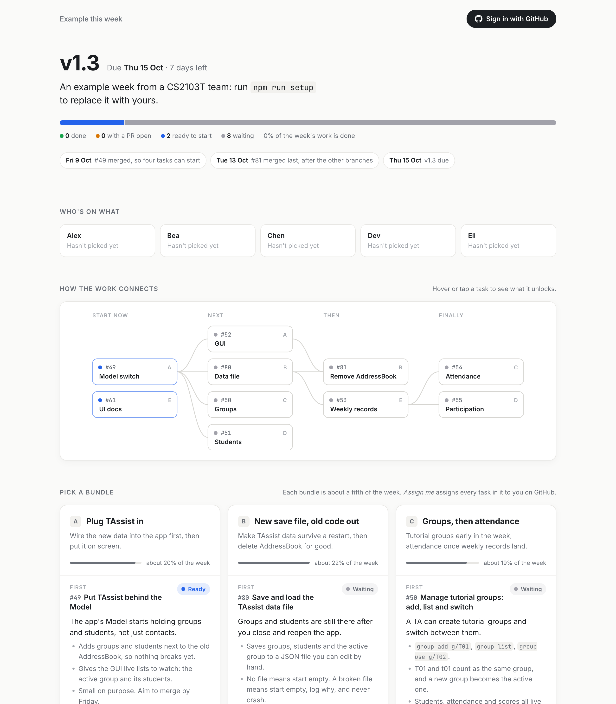

# Weekly team dashboard

A one-page dashboard that turns your team's milestone issues into a plan people can read in a minute:

- **This week at a glance:** the milestone, days left, and one progress bar coloured by status (waiting, ready, PR open, done).
- **How the work connects:** a dependency map built from GitHub's "blocked by" links. Hover a task to light up what it waits on and what it unlocks.
- **Five even bundles:** the week's issues split into one bundle per teammate, balanced by estimated effort. Each task is explained in plain English, because issues written for coding agents are hard for people to skim.
- **Assign me:** sign in with GitHub, click a bundle, and every issue in it is assigned to you on the group repo. The page then zooms into your part of the week.

The plan is written each week by a [Claude Code](https://claude.com/claude-code) skill in this repo, inspired by [eli5](https://github.com/dreambigou/eli5). It reads the milestone and your code, proposes issue changes that let more people work in parallel, and only touches GitHub after you approve.

It runs free on Cloudflare Workers. You don't need a server.



## How it works

- `public/` is the page (`index.html`, `app.js`, `style.css`). `public/data/plan.json` holds the week's plan.
- `src/worker.js` is a Cloudflare Worker that signs teammates in through a GitHub App, reads live issue and PR status, and assigns or unassigns a bundle's issues as the signed-in person.
- `.claude/skills/weekly-plan/` is the Claude Code skill that writes the plan.
- `scripts/setup.mjs` configures the repo for your team. `scripts/check-plan.mjs` checks a plan against GitHub.

**Security:**
- Only the GitHub accounts listed in `TEAM_LOGINS` can sign in or assign anything. Everyone else can only read the published plan.
- The GitHub App is installed on your group repo only, with Issues write and Pull requests read. Each action runs as the teammate who clicked.
- The sign-in cookie is encrypted and HttpOnly. Requests from other sites are refused.
- Which issues a bundle contains comes from the published plan, never from the request.

## What you need

- Your team's issues on GitHub, with a milestone per week. "Blocked by" links make the dependency map useful.
- A free [Cloudflare](https://dash.cloudflare.com/sign-up) account. A domain is optional; without one you get a free `workers.dev` address.
- [Node.js](https://nodejs.org) 20 or newer, and the [GitHub CLI](https://cli.github.com) signed in with `gh auth login`.
- [Claude Code](https://claude.com/claude-code) to write the weekly plan. You can also write `plan.json` by hand; its format is in the skill file.
- Owner access to your team's GitHub organization, to create and install the GitHub App. If you don't have it, ask whoever does.

## Set up

### 1. Make your copy

Click **Use this template** → **Create a new repository**. Private is fine. Keep it **out of your tP repo**: RepoSense counts every line there.

```bash
git clone https://github.com/YOUR-NAME/YOUR-DASHBOARD.git
cd YOUR-DASHBOARD
npm install
npm run setup
```

`npm run setup` asks for your team name, group repo, teammates and domain. It suggests answers from GitHub where it can, then writes `wrangler.jsonc` and an empty plan.

### 2. Write this week's plan

Open Claude Code in the folder and ask it to *write this week's plan*. The `weekly-plan` skill:

1. reads the milestone,
2. proposes any issue changes and waits for your OK,
3. writes the bundles and summaries,
4. runs `npm run check`.

To preview it, run `npm run dev` and open http://localhost:8787.

Commit and push.

### 3. Deploy on Cloudflare

1. In the Cloudflare dashboard, go to **Workers & Pages** → **Create** → **Import a repository**, and pick your repo.
2. Set **Project name** to the Worker name from setup. It must match `name` in `wrangler.jsonc`, or the build fails.
3. Leave **Build command** empty and keep **Deploy command** as `npx wrangler deploy`. Leave **Preview builds** and **Cloudflare Access** off.
4. Click **Deploy**.

From now on, every push to `main` redeploys automatically. If you didn't enter a domain, the page shows your `workers.dev` address once the deploy finishes. You need that address for the next step.

### 4. Create the GitHub App

Go to your organization's **Settings** → **Developer settings** → **GitHub Apps** → **New GitHub App** (`https://github.com/organizations/YOUR-ORG/settings/apps/new`).

| Field | Value |
|---|---|
| GitHub App name | e.g. `T12-4 Dashboard`. Names are unique across GitHub, and teammates see this one when signing in. |
| Homepage URL | your dashboard address, e.g. `https://dash.example.com` |
| Redirect URI | the same address followed by `/auth/callback` |
| Allow wildcard matching | leave unticked |
| Expire user authorization tokens | leave ticked (the Worker refreshes them) |
| Request user authorization (OAuth) during installation | leave unticked |
| Enable Device Flow | leave unticked |
| Setup URL, Redirect on update | leave blank and unticked |
| Webhook → Active | **untick** |
| Permissions → Repository permissions → **Issues** | **Read and write** |
| Permissions → Repository permissions → **Pull requests** | **Read-only** |
| Everything else | No access (Metadata becomes read-only by itself) |
| Where can this GitHub App be installed? | Only on this account |

Then:

1. Click **Create GitHub App**.
2. Copy the **Client ID** into `GITHUB_CLIENT_ID` in `wrangler.jsonc`, then commit and push.
3. Click **Generate a new client secret** and copy it right away. GitHub shows it only once.
4. Go to **Install App** → your organization → **Only select repositories** → your group repo.

### 5. Add the secrets

In Cloudflare, open your Worker → **Settings**. Use the **Variables and Secrets** section near the **top** of the page. The similar-looking one under **Build** is only visible during the build, and sign-in fails if you use it.

Add two entries, both with **Type: Secret**:

| Name | Value |
|---|---|
| `GITHUB_CLIENT_SECRET` | the client secret from step 4 |
| `SESSION_SECRET` | a long random string, e.g. the output of `openssl rand -hex 32` |

Save. Make sure it actually deploys: if you only see **Save version**, deploy that version from the **Deployments** tab.

Now open your dashboard, sign in with GitHub, and try **Assign me**.

## Every week

On milestone deadline day, open Claude Code in this folder and ask it to *refresh the dashboard for the next milestone*. It archives last week, plans the new one, waits for your go-ahead, then commits and pushes. Cloudflare deploys within a minute or two.

## Local development

```bash
npm run dev
```

This serves http://localhost:8787. Real sign-in only works on the deployed address, so for local testing create a `.dev.vars` file (it's gitignored):

```
SESSION_SECRET=anything
GITHUB_TOKEN=<a read-only GitHub token, for live status>
DEV_FAKE_LOGIN=<your GitHub username>
```

`DEV_FAKE_LOGIN` makes the local Worker treat you as signed in. **Assign me** then fakes a 1.5-second GitHub call without changing any issue, so you can safely try the claim animation. Never set it in Cloudflare.

View transitions are skipped when the tab isn't visible, so open the preview in a visible browser window to see the animation.

## Troubleshooting

| What you see | Why |
|---|---|
| `The client_id and/or client_secret passed are incorrect` | `GITHUB_CLIENT_SECRET` is missing or wrong at runtime. Check it is in the top **Variables and Secrets** section (not under Build), its type is Secret, and that version is deployed. |
| GitHub says the redirect URI is not associated with the app | The Redirect URI in the GitHub App must exactly match your address plus `/auth/callback`, with `https` and no trailing slash. |
| Signed in, but no live status | The GitHub App is not installed on the group repo, or is missing the Issues or Pull requests permission. |
| "Only members of team … can sign in" | Your GitHub username is not in `TEAM_LOGINS` in `wrangler.jsonc`. |
| Cloudflare build fails about the Worker name | The Cloudflare project name must equal `name` in `wrangler.jsonc`. |
